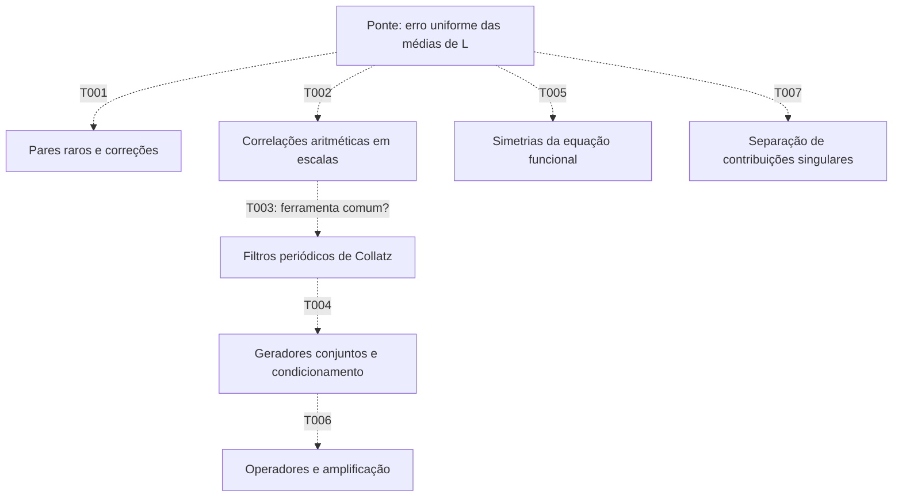

# Mapa inicial de conexões

14/10/2026. As ligações propostas abaixo são perguntas de pesquisa, não teoremas. As bases matemáticas de cada uma estão nas fichas.

| ID | Temas aproximados | O que pode acrescentar à ponte | Primeiro alvo | Prioridade |
| --- | --- | --- | --- | --- |
| [T001](T001_PARES_RAROS.md) | Pares próximos, eventos raros, expansões por regiões | Explicação de uma correção que não sobrevive à troca de média e expansão | Recuperar o defeito conhecido de −1/2 no CUE(2), isolando a região de gap da ordem ε | Alta |
| [T002](T002_CORRELACOES_ESCALAS.md) | Fourier/Mellin, correlações aditivas e escalas | Localizar o cancelamento fora da diagonal | Propagar o erro de log(1+h/m)≈h/m pelo núcleo e pelas somas | Alta |
| [T003](T003_FAMILIAS_COLLATZ_RIEMANN.md) | Filtros de Collatz, caracteres e Fourier finita | Uma família comum de operações e estimativas | Tabela exata de transformações, módulos e normas | Exploratória |
| [T004](T004_CUSTO_PRESSAO.md) | Condicionamento, funções geradoras e transferência | Controle da extração de custos/resíduos | Função geradora conjunta antes de condicionar, com normalização explícita | Exploratória |
| [T005](T005_SIMETRIAS_FUNCIONAIS.md) | Equação funcional, reflexão e correções | Restrições que toda aproximação deve respeitar | Derivar identidades locais de derivadas nos zeros | Média |
| [T006](T006_RESOLVENTES_TRANSIENTES.md) | Operadores não normais, resolventes e transientes | Identificar amplificação não vista nos autovalores | Um operador concreto, espaço e norma, sem espectro inserido | Exploratória |
| [T007](T007_PARTES_CONECTADAS.md) | Subtração de singularidades e grupos de contribuições | Reorganizar o resto sem usar a resposta como entrada | Decomposição por pares no CUE, com controle da dependência do corte | Média |
| [T008](T008_INTERMITENCIA_COLLATZ.md) | Concentração, colisões e integrabilidade | Entender classes excepcionais além da mistura média | Recorrência de energia com correlações cruzadas | Alta na frente Collatz |
| [T009](T009_HILBERT_MEMORIA.md) | Hilbert, memória quântica e primeira passagem | Preservar informação que o determinante perde | Cota não trivial de um funcional de primeira chegada | Exploratória |
| [T010](T010_PONTE_MODULAR.md) | Ramos afins, frações contínuas e Selberg | Comparar com uma ponte dinâmica–zeta demonstrada | Espaços, pesos e possível entrelaçamento, após a obstrução projetiva | Risco alto |

## Visão das perguntas

Linhas pontilhadas significam uma interconexão a investigar. Elas não afirmam que Collatz explique os zeros de Riemann.

## Critério de avanço

Uma conexão merece aprofundamento se entregar pelo menos uma destas coisas: identidade não circular, estimativa útil, previsão que não foi usada como entrada, ou obstrução que exclua uma construção concreta. O fato de duas áreas empregarem “espectro”, “zeta”, “simetria” ou “caos” não basta.

A novidade bibliográfica de todas as propostas permanece **não estabelecida**. Os primeiros alvos conhecidos são controles de método; a oportunidade científica estaria em um passo adicional que sobreviva à comparação com a literatura.
